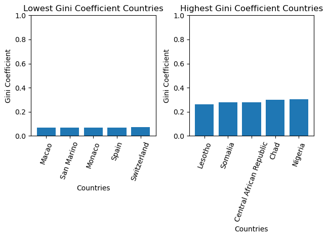
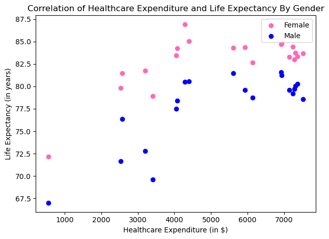
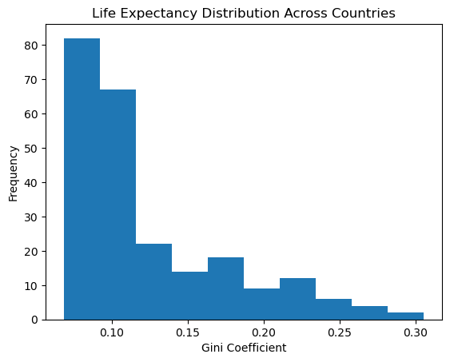
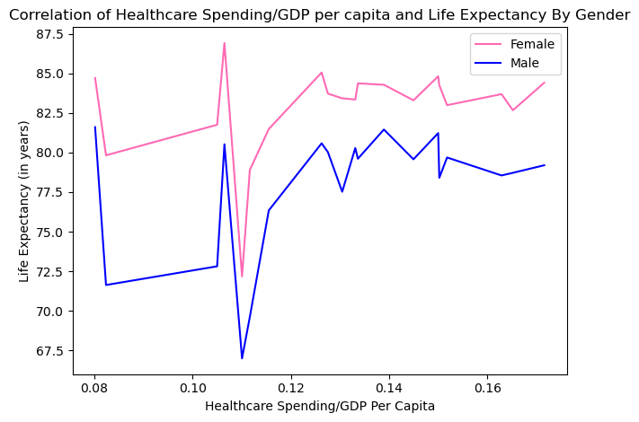
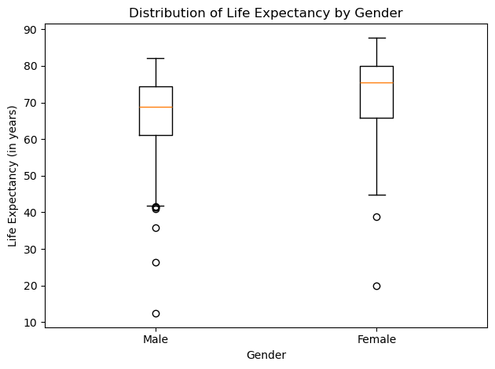

# Economic Indicators & Life Expectancy: A Python Data Engineering Pipeline

**Purdue University · CS 17600: Data Engineering in Python · Final Project (Fall 2024)**

An end-to-end data engineering and analysis project in **Python, pandas and Matplotlib**. It takes four public global health datasets (**more than 160,000 raw rows** in total), joins them into one analysis-ready table, cleans and reshapes it, and uses visualizations and pivot tables to study how **healthcare spending, GDP per capita and lifespan inequality** relate to **male and female life expectancy** across countries from 2000 to 2021.

| | |
|---|---|
| **Languages & tools** | Python 3.12, pandas, Matplotlib, Jupyter Notebook |
| **Data techniques** | Multi-source ingestion, multi-key joins, feature engineering, missing-value handling, filtering, grouping, MultiIndex DataFrames, pivot tables, reshaping (`stack`) |
| **Analysis outputs** | 5 visualizations (bar, scatter, histogram, line, box plot) and 3 pivot tables |
| **Scale** | 4 source files, ~162K raw rows, reduced to a 3,336-row clean panel plus a 236-country cross-section |
| **Deliverables** | [`CS_176_Final_Project.ipynb`](CS_176_Final_Project.ipynb) (code) and [`CS 176 Final Report.pdf`](CS%20176%20Final%20Report.pdf) (20-page written report) |

---

## Research question

> *How do key economic indicators (healthcare expenditure, GDP per capita and lifespan inequality) relate to life expectancy for men and women around the world?*

---

## Data sources

The project uses four CSV files from the [**Life Expectancy Around the World**](https://www.kaggle.com/datasets/mahdiehhajian/life-expectancy-around-the-world) dataset on Kaggle. The files are built from Our World in Data indicators.

| File | Raw rows | Key fields used |
|---|---:|---|
| `life-expectancy-of-women-vs-life-expectancy-of-men.csv` | 18,992 | Female and male life expectancy at birth |
| `life-expectancy-vs-healthcare-expenditure.csv` | 59,762 | Health expenditure per capita (PPP, international $), overall life expectancy |
| `life-expectancy-vs-gdp-per-capita.csv` | 64,641 | GDP per capita |
| `life-expectancy-versus-gini-lifespan-inequality.csv` | 19,280 | Gini coefficient of lifespan inequality, population, continent |

> The CSV files are not stored in this repository. See [How to run](#how-to-run) to download them.

---

## Pipeline architecture

```
 4 raw CSVs ──► Ingest ──► Merge ──► Feature engineering ──► Clean ──► Group / Filter ──► Visualize & Pivot
               (pandas)  (inner join   (spending ÷ GDP        (normalize   (by continent,     (Matplotlib,
                          on Country    ratio)                 nulls,       most recent        pivot_table,
                          + Year)                              dropna)      year)              stack)
```

### 1. Ingestion
All four datasets are loaded with `pandas.read_csv`. Each one has country-year records in a long format, and some go back as far as 10,000 BCE.

### 2. Merging (multi-source integration)
- The healthcare expenditure and GDP per capita tables are joined with an **inner join on a composite key (`Entity`, `Year`)**.
- That result is then joined with the male and female life expectancy table on the same key.
- The merged table keeps only the 7 columns the analysis needs.

### 3. Feature engineering
A new metric, **`healthcare spending / GDP per capita`**, is calculated for every country-year. It shows what share of national income per person goes to healthcare, so countries with very different economies can be compared fairly.

### 4. Data cleaning & validation
- A loop standardizes placeholder values such as `''`, `' '`, `'NA'`, `'null'` and `'?'` to `pd.NA`.
- `isnull().sum()` is used to measure missing data **before and after** cleaning. For example, the merged table had 14,791 missing healthcare expenditure values and 15,498 missing ratio values.
- Rows with missing values are removed with `dropna()`, and the null counts are checked again to confirm none remain.
- **Result:** a clean panel of **3,336 country-year records** for 2000–2021, and a cross-section of **236 countries and territories** (2015) with continent labels.

### 5. Filtering & grouping
- **`sortByContinent()`** is a reusable function that splits a DataFrame into a dictionary of DataFrames, one per continent (`{continent: DataFrame}`). This allows each region to be analyzed separately.
- Filters isolate the **most recent year** available (2021) so that countries are compared at the same point in time.
- **Iteration:** the team first filtered to 2014–2024 and kept only each country's latest record. This left fewer than 1,000 rows, which was below the project's data requirement. The team checked the data volume, saw the problem and changed the filtering approach. The written report describes this decision.

### 6. Reshaping & pivoting
- Long, auto-generated column names (for example, `Life expectancy - Sex: female - Age: 0 - Variant: estimates`) are renamed to short, readable names.
- **MultiIndex** DataFrames are built on (`Year`, `Country`) and (`Country`, `Continent`).
- Three **pivot tables** are created:
  1. **Country × Year:** mean male and female life expectancy (`aggfunc='mean'`)
  2. **Country × Year:** healthcare expenditure and GDP per capita
  3. **Continent × Country:** Gini coefficient and overall life expectancy
- `stack()` turns each wide, sparse pivot table back into a compact, readable long format.

---

## Visualizations & findings

### 1. Countries with the lowest and highest lifespan inequality


The lowest Gini values (about 0.07) were in **Macao, San Marino, Monaco, Spain and Switzerland**. The highest (about 0.26–0.31) were in **Lesotho, Somalia, the Central African Republic, Chad and Nigeria**. The countries with the most inequality also had overall life expectancies around 51–55 years, compared with 82–85 years in the countries with the least inequality.

### 2. Healthcare expenditure vs. life expectancy, by sex (2021)


The chart shows a clear **positive association**: across the 20 countries with complete 2021 data, those that spend more on healthcare per person have higher life expectancy for both sexes. The gains level off at higher spending. Female life expectancy is higher than male life expectancy at every level of spending.

### 3. Distribution of lifespan inequality across countries


The distribution is **right-skewed**. Most countries cluster around a Gini value of about 0.10, while a long tail of higher-inequality countries is mostly in Africa.

### 4. Healthcare share of income vs. life expectancy (2021)


There is only a **slight upward trend** after a ratio of about 0.12, with notable exceptions. The **share** of income spent on healthcare is a weaker predictor of life expectancy than the absolute amount spent (see chart 2).

### 5. Global distribution of life expectancy by sex (2000–2021)


Across all 3,336 country-year records, women live longer than men in **every part of the distribution**: minimum, quartiles, median and maximum.

### Pivot-table insights
- Average life expectancy for both sexes **rose steadily** in most countries from 2000 to 2021.
- Healthcare expenditure and GDP per capita **generally increased together**. Some countries show drops around 2019–2020; Zimbabwe is a clear example.
- When countries are grouped by continent, **lower lifespan inequality goes with higher overall life expectancy**.

---

## Key takeaways

1. **Healthcare spending per person is strongly and positively associated with life expectancy** for both men and women.
2. **Lifespan inequality has a negative relationship with life expectancy**: countries where age at death varies more tend to have lower average lifespans.
3. **Women outlive men** in every country group and year studied, regardless of economic conditions.
4. The **share of GDP** spent on healthcare is a much weaker signal than the **absolute** amount spent.

---

## Skills demonstrated

- **Data engineering:** combining several sources, composite-key joins, schema simplification, column renaming, building tidy and long-format data
- **Data quality:** standardizing placeholder values, profiling missing data, checking the data after each change, judging whether there is enough data
- **pandas:** `merge`, `loc`, boolean filtering, `sort_values`, `groupby`-style partitioning, `set_index` (MultiIndex), `pivot_table`, `stack`, `rename`
- **Data visualization:** choosing the right chart for each question (comparison, correlation, distribution, trend, spread) and labeling charts clearly
- **Analytical communication:** turning results into a 20-page technical report written for a non-technical reader
- **Collaboration:** planning and delivering the project with a four-person team, splitting the pipeline into stages and combining everyone's work into one notebook and report

---

## How to run

```bash
git clone https://github.com/Niharika-Rai/cs176.git
```

```bash
cd cs176
```

```bash
pip install pandas matplotlib jupyter
```

Download these four CSV files from the [Kaggle dataset](https://www.kaggle.com/datasets/mahdiehhajian/life-expectancy-around-the-world) and put them in the project root:

- `life-expectancy-of-women-vs-life-expectancy-of-men.csv`
- `life-expectancy-vs-healthcare-expenditure.csv`
- `life-expectancy-vs-gdp-per-capita.csv`
- `life-expectancy-versus-gini-lifespan-inequality.csv`

```bash
jupyter notebook CS_176_Final_Project.ipynb
```

Run the cells from top to bottom.

---

## Repository structure

```
cs176/
├── CS_176_Final_Project.ipynb   # Full pipeline: ingest → merge → clean → group → visualize → pivot
├── CS 176 Final Report.pdf      # 20-page written report: method, charts, findings
├── images/                      # Charts exported from the notebook
└── README.md
```

---

## Limitations & future work

Possible next steps for this project:

- **Clarify the inequality metric.** The source data's Gini coefficient measures how spread out ages at death are **among women**. It does not directly measure the gap between men and women. A future version could calculate the male–female gap directly (female minus male life expectancy) to answer that question.
- **Missing-data strategy.** Removing incomplete rows left a 2021 sample of only 20 countries, mostly high-income ones. Interpolating within each country or analyzing year by year would give wider coverage.
- **Statistical rigor.** Correlation coefficients and regressions (for example, life expectancy against log health spending, with GDP as a control) would put numbers on the patterns that are currently shown visually. These would also help separate correlation from causation.
- **Engineering.** The notebook could be refactored into reusable modules with a `requirements.txt`, automated data download and unit tests for the cleaning steps.

---

## Team

Built by **Niharika Rai**, Rachel Carlson, Nyree Ruiz and Elia Lies for Purdue University's CS 17600: Data Engineering in Python (December 2024).
